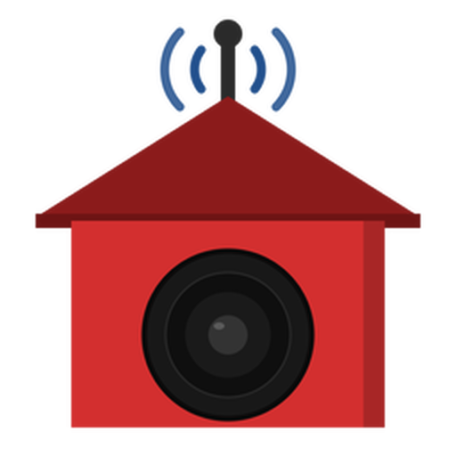
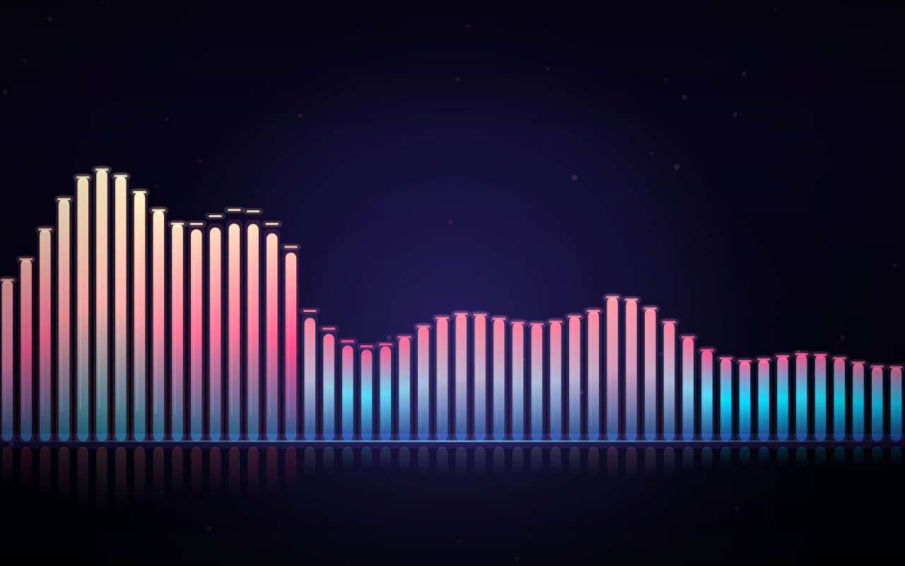
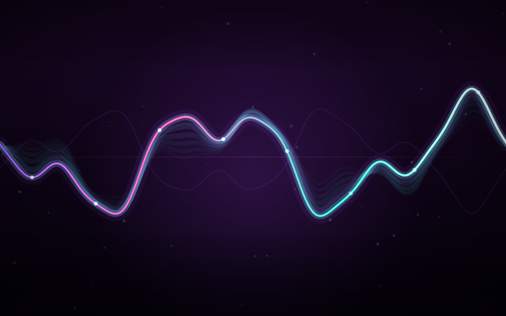
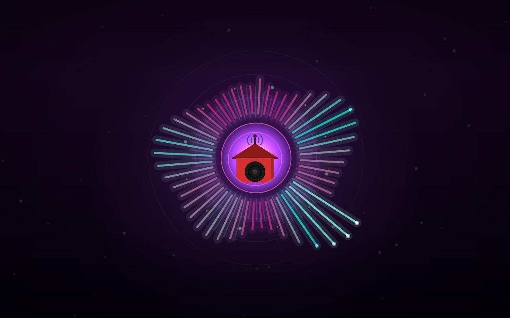
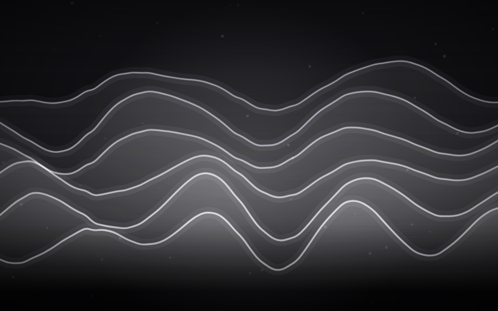
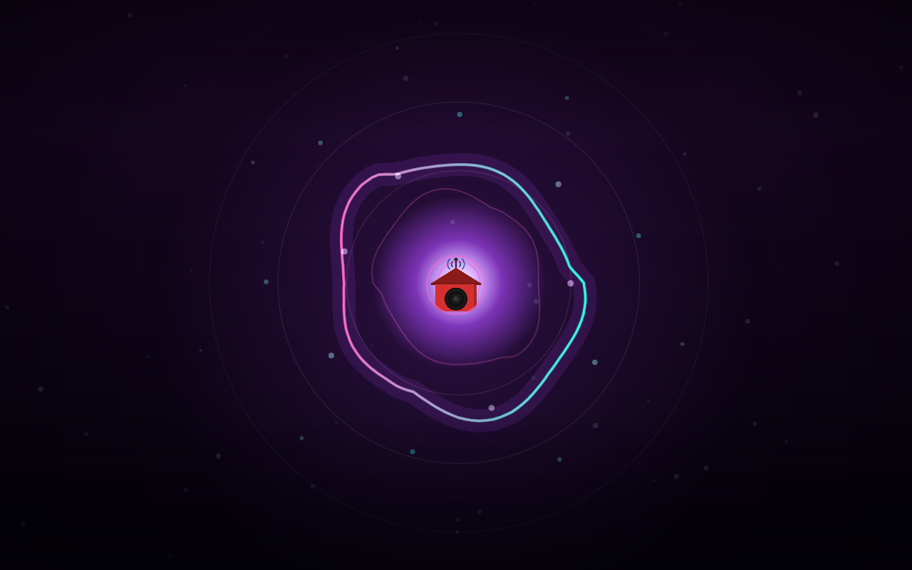
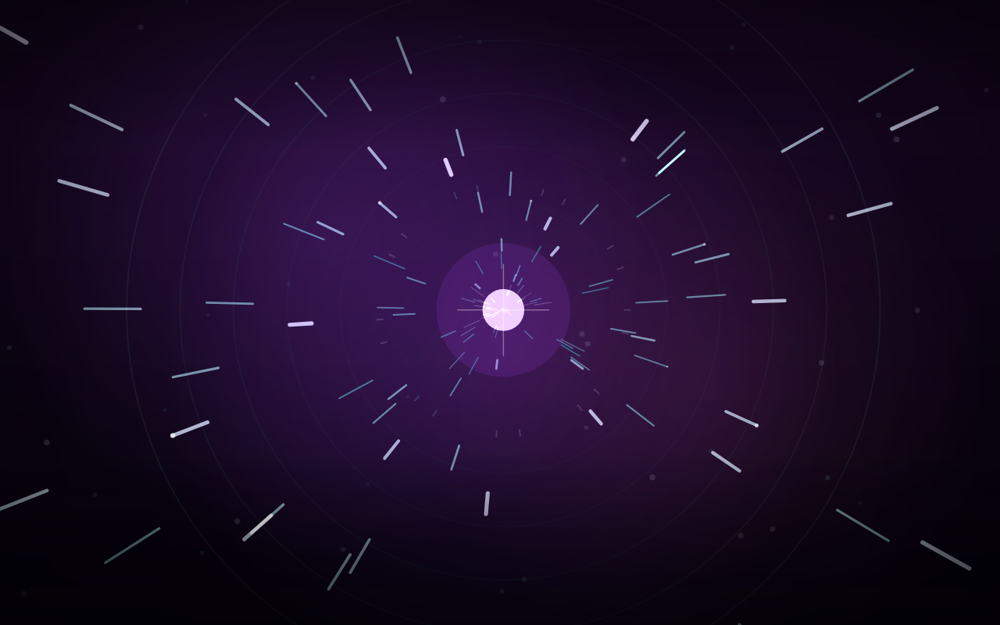
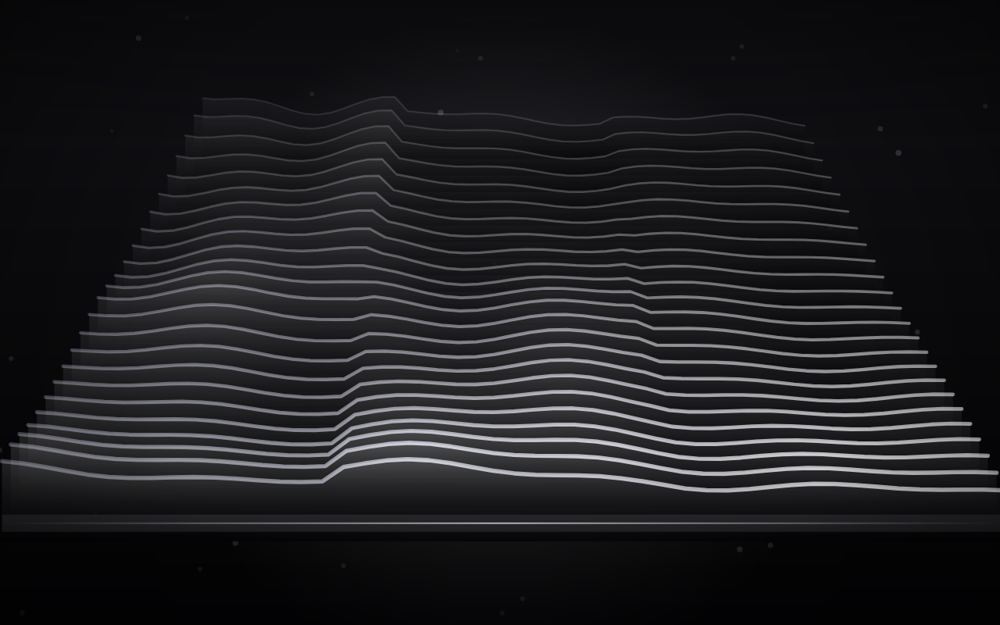
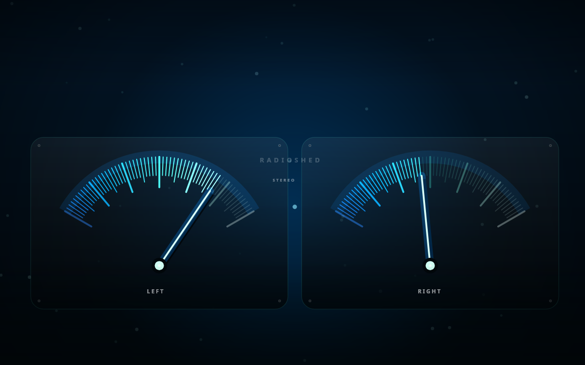
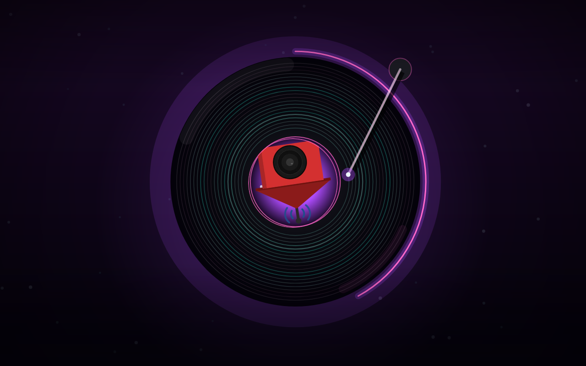

<!-- SPDX-FileCopyrightText: 2026 VisorCraft LLC -->
<!-- SPDX-License-Identifier: GPL-3.0-only -->

<p align="center">
  
</p>

<h1 align="center">RadioShed</h1>

<p align="center">
  <a href="https://github.com/visorcraft/RadioShed/releases/latest"></a>
  <a href="LICENSE"></a>
  
  
  
</p>

<p align="center">
  <b>Your music turned into stations. No subscriptions, no telemetry, internet optional.</b><br />
  Scan your local library, build rule-driven stations, tune playback, and keep listening on your own terms.
</p>

---

## What is RadioShed?

RadioShed is a private, station-centric music player for your own local library.
It replaces shuffle-heavy playback with personal radio: **your folders, tags,
ratings, and listening history decide what plays next** - without an account or
a subscription.

Three things we care about:

- **Station-centric listening** - combine folders, smart queries, tag filters, and path patterns with configurable shuffle, weighting, and repeat avoidance.
- **Local & private** - your library and listening data stay on your device. Optional artwork and lyrics lookups respect granular connectivity policies.
- **Cross-platform & open** - one [Kotlin Multiplatform](https://kotlinlang.org/docs/multiplatform.html) and [Compose Multiplatform](https://www.jetbrains.com/compose-multiplatform/) app for Android and desktop, licensed under GPL v3.

### What it covers today

**Library & metadata**
- Recursive local-folder scans with include/exclude globs and incremental rescans
- Songs, artists, albums, and genres with sorting, filtering, full-text search, and a power-user search syntax
- Embedded artwork and lyrics, single-track and batch tag editing, duplicate detection, and a built-in file browser

**Stations & playback**
- Built-in and custom stations with source rules, pinned tracks, playback weighting, no-repeat memory, and artist/album spacing
- Priority queue, playlists, likes, five-star ratings, listening history, and listening statistics
- Gapless playback, configurable crossfade, ReplayGain, a five-band equalizer, and a sleep timer
- Cinematic fullscreen visualizer with nine beat-reactive scenes, musical build/drop choreography, luminous trails and particles, five palettes, live Android FFT/waveform capture, and clearly labeled ambient desktop visuals

**Metadata & discovery**
- Optional Cover Art Archive artwork and LRClib lyrics with synced-line highlighting and seek
- Smart Shuffle, Forgotten Gems, Adaptive Mix, and decade stations
- Subsonic browsing and ListenBrainz scrobbling with offline queueing, plus Syncthing detection
- Desktop audio through a direct JNA binding to the host's libvlc 3.x; Android audio through Media3

**Android, desktop & portability**
- Android Auto, Drive Mode with Bluetooth/schedule triggers, home-screen widgets, and backup sharing
- Predictable D-pad navigation with visible focus and scrubber seeking on TVs and projectors
- Import/export `.rsbak` backups with settings, stations, playlists, history, ratings, likes, and artwork
- Linux AppImage and `.deb` packaging; Windows MSI packaging; macOS DMG configuration

Android 11+ is the primary mobile target, including Android 14 on the HY450 Max
projector. Linux x86_64 and Windows 11 are the current desktop targets. The iOS
source set remains a stub pending macOS development access. See [`SPEC.md`](SPEC.md)
for the roadmap and [`USER_GUIDE.md`](USER_GUIDE.md) for detailed workflows.

---

## A light show built for your music

Nine distinct scenes turn playback into a living light show. The same Compose
engine powers Android's live FFT/waveform analysis and clearly labeled ambient
visuals on desktop. These are real renders from the app, not mockups.

| | | |
| :---: | :---: | :---: |
| [](docs/screenshots/spectrum.png)<br/>**Prism Spectrum**<br/>Frequency bars, luminous peaks, and mirrored reflections. | [](docs/screenshots/oscilloscope.png)<br/>**Neon Oscilloscope**<br/>Live waveforms with a crisp core and luminous echoes. | [](docs/screenshots/bloom.png)<br/>**Radial Bloom**<br/>Album art at the center of an audio-reactive sunburst. |
| [](docs/screenshots/aurora.png)<br/>**Aurora Ribbons**<br/>Silky layered fields that swell with musical tension. | [](docs/screenshots/ripples.png)<br/>**Bass Ripples**<br/>Beat-driven rings, particles, and radial waveforms. | [](docs/screenshots/hyperspace.png)<br/>**Hyperspace**<br/>Star tunnels that accelerate into musical builds. |
| [](docs/screenshots/waterfall.png)<br/>**Spectral Waterfall**<br/>A flowing three-dimensional history of the track. | [](docs/screenshots/vu.png)<br/>**Analog VU**<br/>Backlit stereo meters with smooth needle ballistics. | [](docs/screenshots/vinyl.png)<br/>**Vinyl Turntable**<br/>Reactive grooves, rotating art, a progress rim, and tonearm. |

---

## Setup (build from source)

### Prerequisites

- [JDK 17+](https://adoptium.net/)
- **Android builds:** Android SDK platform `android-37`, build-tools `36.0.0`, platform-tools, and cmdline-tools
- **Desktop playback:** VLC/libvlc 3.x installed on the host
- **Linux packaging:** `dpkg-deb` for `.deb` packages; AppImageKit is downloaded automatically when not supplied

Point Gradle at your Android SDK with `sdk.dir` in the gitignored
`local.properties`, or set `ANDROID_HOME` / `ANDROID_SDK_ROOT`.

### Run in development

```sh
# Launch the Compose Desktop app
./gradlew :composeApp:run

# Build an Android debug APK
./gradlew :composeApp:assembleDebug

# Install it on a connected Android device
adb install -r composeApp/build/outputs/apk/debug/composeApp-debug.apk
```

The desktop runtime discovers libvlc through standard per-OS install paths.
Without it, the app still launches, but playback is unavailable.

---

## Install

Grab a prebuilt package from the [**Releases**](https://github.com/visorcraft/RadioShed/releases/latest)
page, or build your own from the repository root. The current release,
[**RadioShed 1.10.0**](https://github.com/visorcraft/RadioShed/releases/tag/v1.10.0),
includes a signed Android APK, a Linux AppImage, and a `.deb` package.

| Target | Command |
| --- | --- |
| Android - debug APK | `./gradlew :composeApp:assembleDebug` |
| Android - release APK / AAB | `./gradlew :composeApp:assembleRelease` / `./gradlew :composeApp:bundleRelease` |
| Linux - single-file AppImage | `./gradlew :composeApp:packageSingleFileAppImage` |
| Linux - `.deb` | `./gradlew :composeApp:packageDistributionForCurrentOS` |
| Windows - `.msi` / macOS - `.dmg` | `./gradlew :composeApp:packageDistributionForCurrentOS` on the matching host |
| Desktop - unpacked app directory | `./gradlew :composeApp:createDistributable` |

Android release APK/AAB output is unsigned by default when built locally. Desktop
installers must be packaged on their target host OS. See
[`AGENTS.md`](AGENTS.md#releases) for artifact paths and the release-signing recipe.

On Arch Linux and derivatives, install the x86_64 AppImage through the
[AUR](https://aur.archlinux.org/packages/radioshed):

```sh
yay -S radioshed
# Or: paru -S radioshed
```

The [release workflow](.github/workflows/release.yml) builds and publishes the
per-platform release assets. Desktop playback still requires host libvlc; the
AppImage does not bundle it.

---

## Tweak

### First run

1. Add one or more music folders during onboarding or in **Settings → Library Settings**.
2. Scan the library, then review the detected songs, artists, albums, and genres.
3. Edit a built-in station or create your own from Stations Home.
4. Set **Always**, **Wi-Fi only**, or **Never** before enabling online artwork and lyrics lookups.
5. Export a backup after your folders, stations, playlists, and settings are configured.

### Everyday use

- Use stations for repeat listening patterns and playlists for hand-picked track lists.
- Keep music paths stable; after moving files, update the registered folders and rescan.
- Long-press tracks and stations for context actions, queue controls, editing, and sharing.
- Customize theme, dynamic color, font scale, motion, Now Playing layout, and station tiles under **Settings → Display**.
- See [`FAQ.md`](FAQ.md) for troubleshooting and [`USER_GUIDE.md`](USER_GUIDE.md) for the complete feature guide.

### Environment variables

| Variable | Purpose |
| --- | --- |
| `ANDROID_HOME` / `ANDROID_SDK_ROOT` | Locate the Android SDK when `local.properties` is not used |
| `RADIOSHED_LIBVLC_PATH` | Override the desktop libvlc shared-library path |
| `APPIMAGETOOL` | Use a specific AppImageKit `appimagetool` executable for Linux packaging |

---

## Contribute

Contributions are welcome - issues, fixes, and features alike.

**Quick rules:**

- Read [`CONTRIBUTING.md`](CONTRIBUTING.md) and [`AGENTS.md`](AGENTS.md), match the existing Kotlin style, and keep commits focused.
- Run `./gradlew :composeApp:desktopTest` and `./gradlew :composeApp:testDebugUnitTest` before pushing changes.
- After SQLDelight schema changes, regenerate with `./gradlew :composeApp:generateCommonMainRadioShedDatabaseInterface --rerun-tasks` and add a new migration rather than editing a shipped one.
- After dependency changes, update the license catalog and run `./gradlew :composeApp:generateThirdPartyLicenses`.
- RadioShed is **GPL v3** - derivative works must stay open source under compatible terms.

---

## Licence

RadioShed is licensed under the [GNU General Public License v3.0](LICENSE). Copyright © 2026 VisorCraft LLC.
